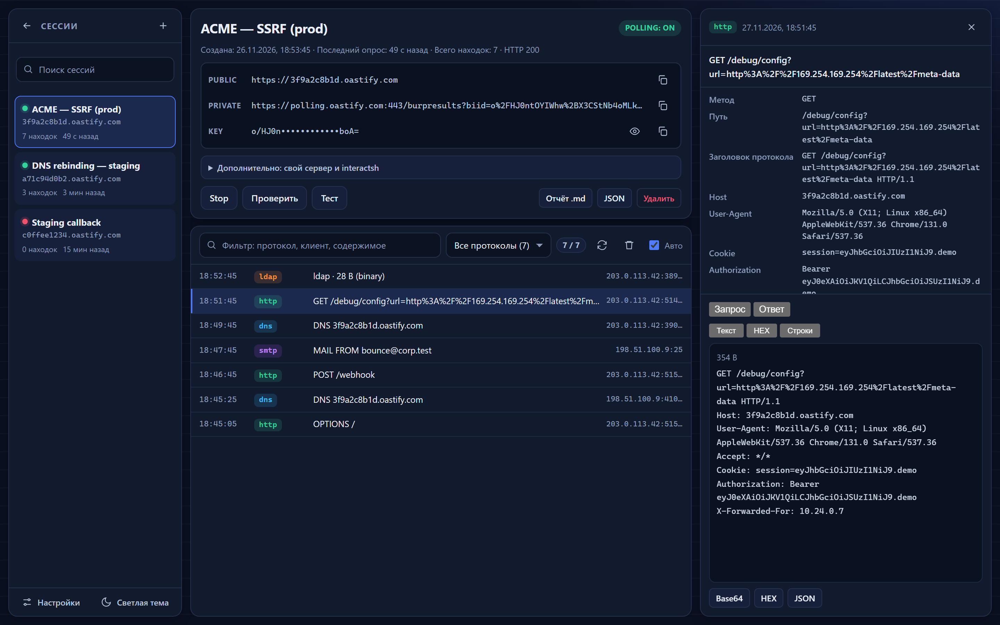
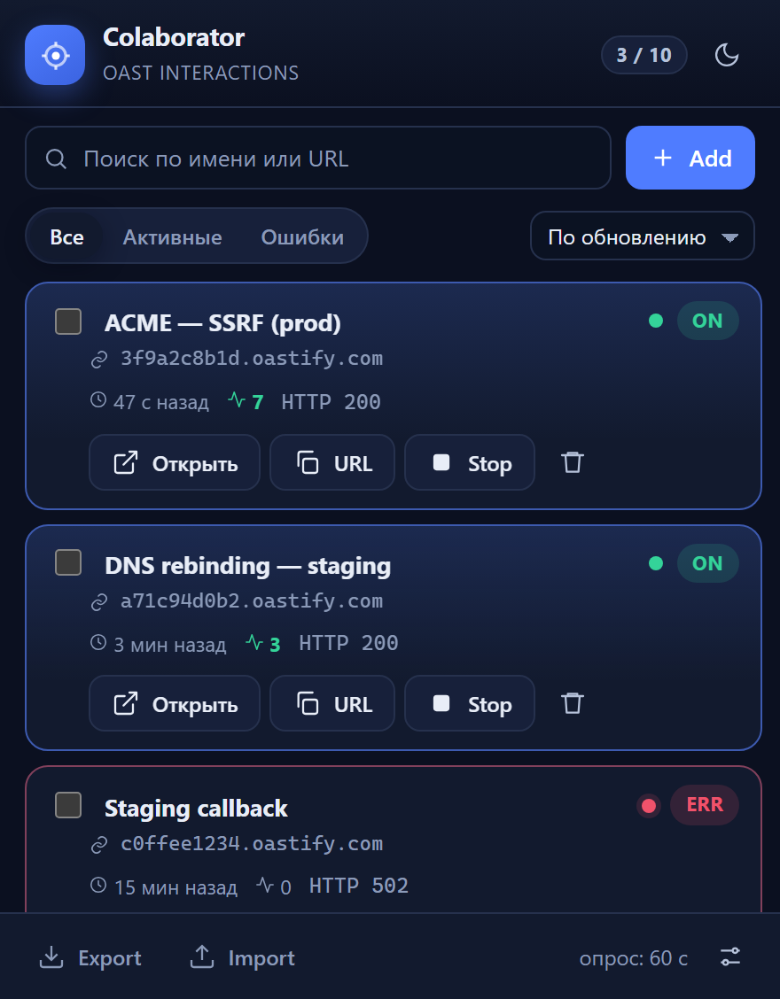
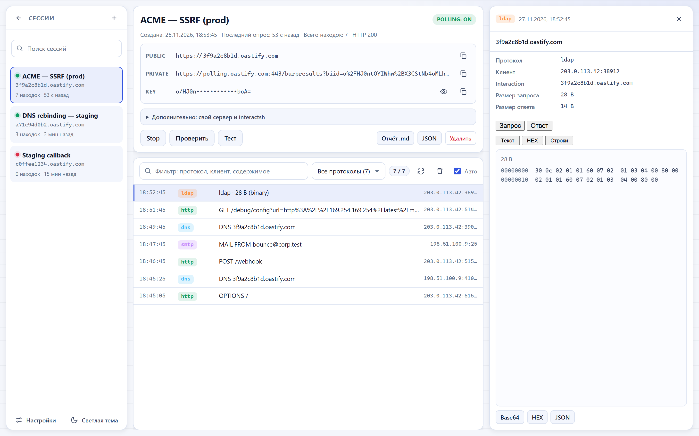
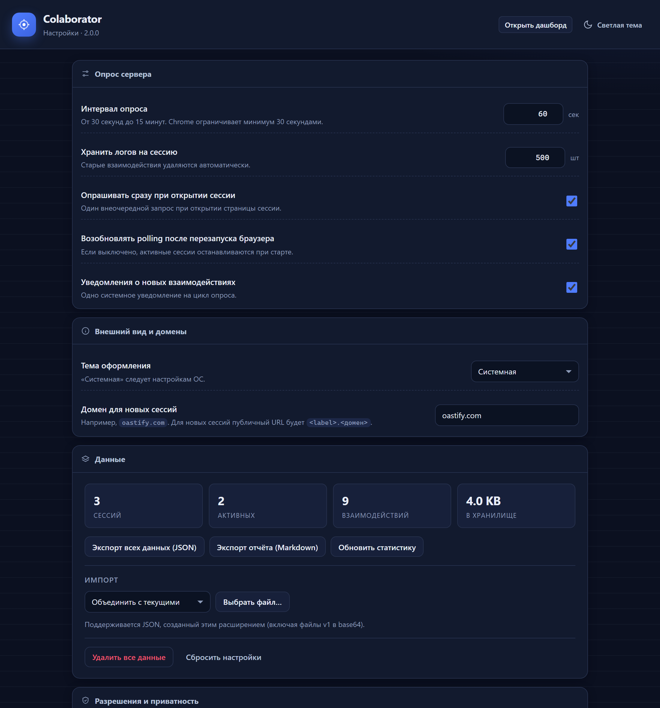
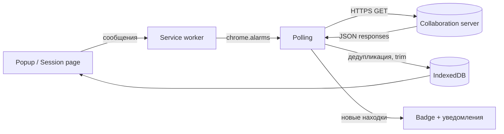

# Colaborator

[](https://github.com/RedDySter20/ColaboratorExtension/actions/workflows/ci.yml)
[](LICENSE)
[](https://developer.chrome.com/docs/extensions/develop/migrate/what-is-mv3)
[](CHANGELOG.md)

**Многосессионный OAST-дашборд для браузера.** Расширение создаёт сессии
коллаборации (Burp Collaborator-совместимые и self-hosted interactsh), опрашивает
их по расписанию и превращает «сырые» взаимодействия в читаемый журнал с
декодированием HTTP/DNS/SMTP/LDAP-запросов, hex-просмотром и экспортом отчёта.

<p align="center">
  
</p>

> [!WARNING]
> Инструмент предназначен **только для авторизованного тестирования**. Используйте
> его исключительно против систем, на работу с которыми у вас есть письменное
> разрешение. Ответственность за использование несёт пользователь.

---

## Содержание

- [Зачем это нужно](#зачем-это-нужно)
- [Возможности](#возможности)
- [Скриншоты](#скриншоты)
- [Установка](#установка)
- [Быстрый старт](#быстрый-старт)
- [Как это работает](#как-это-работает)
- [Настройки](#настройки)
- [Импорт и экспорт](#импорт-и-экспорт)
- [Горячие клавиши](#горячие-клавиши)
- [Совместимость с серверами](#совместимость-с-серверами)
- [Приватность и разрешения](#приватность-и-разрешения)
- [Разработка](#разработка)
- [Ограничения](#ограничения)
- [Решение проблем](#решение-проблем)
- [Планы](#планы)
- [Лицензия](#лицензия)

---

## Зачем это нужно

Для проверки blind-уязвимостей (SSRF, XXE, blind SQLi, RCE без вывода,
open redirect, SSRF в облачные метаданные) нужен внешний «маячок»: сервер,
который зафиксирует, что уязвимая система отправила запрос наружу.

Классический сценарий: Burp Collaborator или interactsh дают уникальный домен, но
работать с ними в браузере неудобно — нет нормального журнала, поиска,
hex-просмотра, истории и отчётов. Colaborator закрывает именно эту часть:

- до **10 параллельных сессий** — по одной на тестируемый хост/уязвимость;
- автоматический polling с настраиваемым интервалом и backoff при ошибках;
- журнал взаимодействий с фильтрами, поиском по содержимому и раскладкой по протоколам;
- инспектор: разобранный HTTP-запрос, DNS-вопрос, SMTP-диалог, hexdump с offset'ами;
- экспорт JSON (бэкап/перенос) и Markdown-отчёт для вставки в пентест-отчёт.

## Возможности

### Сессии

| Возможность    | Детали                                                                                          |
| -------------- | ----------------------------------------------------------------------------------------------- |
| Создание       | До 10 сессий на профиль браузера, ключ — 32 случайных байта (`crypto.getRandomValues`)          |
| Идентификаторы | Полностью совместимы с v1.x и reference-алгоритмом interactsh (SHA-1 → base36 → correlation id) |
| Управление     | Start / Stop, массовые Start/Stop, копирование URL и конфигурации, удаление с подтверждением    |
| Состояние      | Polling ON/OFF, ошибка, время последнего опроса, HTTP-статус, счётчик находок                   |
| Свой сервер    | Public/Private URL и secret для self-hosted interactsh — в блоке «Дополнительно»                |

### Журнал взаимодействий

- Автоматическое обновление (алгоритм `chrome.alarms`, минимум 30 секунд).
- Дедупликация: сервер может отдать одно и то же взаимодействие дважды — в базе
  оно останется в единственном экземпляре (fingerprint + индекс в IndexedDB).
- Фильтры по протоколу и по свободному тексту — поиск идёт **по декодированному
  содержимому запроса**, а не по base64.
- Пагинация по 100 записей, навигация с клавиатуры (`j`/`k`, `↑`/`↓`).
- Настраиваемое хранение: 50…5000 записей на сессию, старые вытесняются.

### Инспектор

Для каждой записи доступны:

- краткое описание (`GET /debug/config?…`, `DNS 3f9a2c8b1d.oastify.com`);
- структурированные поля: метод, путь, `Host`, `User-Agent`, `Cookie`,
  `Authorization`, `X-Forwarded-For`, тип DNS-записи, `MAIL FROM`/`RCPT TO`/`Subject`
  и другие «интересные» заголовки;
- три режима просмотра запроса и ответа: **текст** (с байтовыми подсказками),
  **HEX** (offset + ASCII-гуттер) и **строки** (`strings`-подобное извлечение);
- копирование в буфер: base64, HEX, полный JSON записи.

### Данные и отчёты

- Экспорт: JSON v2 (читаемый, с распакованными payload'ами) и Markdown-отчёт.
- Импорт: JSON v2, JSON v1 и legacy base64-обёртка — режимы «объединить» и «заменить».
- Резервная копия всей базы и статистика по хранилищу в настройках.

### Оформление

- Тёмная и светлая темы + режим «как в системе» (без вспышки при загрузке).
- Уведомления о новых взаимодействиях и счётчик непрочитанного на иконке.
- Всё управление доступно с клавиатуры, есть `aria`-атрибуты и `prefers-reduced-motion`.

## Скриншоты

| Popup                          | Рабочее пространство              |
| ------------------------------ | --------------------------------- |
|  |  |

| Светлая тема и hex-просмотр                   | Настройки                            |
| --------------------------------------------- | ------------------------------------ |
|  |  |

## Установка

Расширение не требует сборки — Chrome загружает исходные ES-модули напрямую.
Нужен Chrome/Chromium/Edge/Brave версии **116+** (Manifest V3, module service worker).

### Вариант 1. Из готового архива

1. Скачайте `ColaboratorExtension-v2.0.0.zip` из раздела
   [Releases](https://github.com/RedDySter20/ColaboratorExtension/releases)
   (или соберите сами: `npm run build:zip` — архив появится в `release/`).
2. Распакуйте архив в любую папку.
3. Откройте `chrome://extensions/` и включите **Режим разработчика**.

   

4. Нажмите **«Загрузить распакованное расширение»** и выберите распакованную папку
   (ту, где лежит `manifest.json`).
5. Закрепите иконку на панели — расширение готово.

### Вариант 2. Из исходников

```bash
git clone https://github.com/RedDySter20/ColaboratorExtension.git
cd ColaboratorExtension
npm ci            # только для тестов/линта; для работы расширения не обязательно
npm run build     # создаст dist/ с проверенной сборкой
```

Затем `chrome://extensions/` → «Загрузить распакованное расширение» → папка `dist/`
(или сразу `src/`, если не хотите собирать).

### Обновление

Замените файлы расширения и нажмите кнопку обновления на карточке расширения.
Данные в IndexedDB сохраняются: схема БД (v2) обратно совместима с v1.x.

## Быстрый старт

1. Откройте popup и нажмите **＋ Add** — появится сессия с публичным доменом вида
   `https://3f9a2c8b1d.oastify.com`.
2. Скопируйте **Public URL** (кнопка `URL` на карточке) и вставьте его в
   параметр, который хотите проверить (SSRF, redirect, webhook и т. п.).
3. Нажмите **Start** — начнётся периодический опрос сервера коллаборации.
4. Откройте сессию (**Открыть**) — взаимодействия появятся в журнале; выберите
   запись, чтобы разобрать её в инспекторе.
5. Кнопка **Тест** отправляет запрос на собственный публичный домен, чтобы
   убедиться, что связка «клиент → сервер → журнал» работает.

Совет: на каждую проверяемую уязвимость создавайте отдельную сессию и
переименовывайте её (`ACME — SSRF в /api/import`) — так отчёт останется читаемым.

## Как это работает



- **Ключ сессии** (32 байта) → SHA-1 → base36 → 22-символьный correlation id →
  детерминированная генерация поддомена. Алгоритм побайтово совпадает с
  reference-реализацией interactsh; совместимость закреплена
  golden-тестами (`tests/fixtures/golden.json`), снятыми с версии 1.3.3.7.
- **Service worker** держит `chrome.alarms` с интервалом из настроек, опрашивает
  активные сессии с ограничением параллелизма (3), применяет экспоненциальный
  backoff при ошибках и обновляет бейдж/уведомления.
- **Хранилище** — IndexedDB (`session_manager_pro`), хранилища `sessions` и `logs`
  с индексами `sessionId`, `ts`, `protocol`, `fingerprint`. Крупные payload'ы
  автоматически упаковываются gzip (совместимо с форматом v1).
- **UI** — обычные ES-модули без бандлера и внешних зависимостей; ни одного
  сетевого запроса, кроме опроса ваших polling-URL.

Подробнее — в [docs/ARCHITECTURE.md](docs/ARCHITECTURE.md).

## Настройки

Страница настроек открывается из popup (⚙) или из карточки расширения
(`chrome://extensions/` → «Расширение» → «Параметры»).

| Параметр                               | По умолчанию  | Описание                                                  |
| -------------------------------------- | ------------- | --------------------------------------------------------- |
| Интервал опроса                        | 60 с          | 30…900 с. Chrome ограничивает минимум 30 секундами        |
| Хранить логов на сессию                | 500           | 50…5000; старые удаляются автоматически                   |
| Опрашивать при открытии сессии         | вкл           | Один внеочередной запрос при открытии страницы            |
| Возобновлять polling после перезапуска | вкл           | Иначе активные сессии останавливаются при старте браузера |
| Уведомления                            | вкл           | Одно системное уведомление на цикл опроса                 |
| Тема                                   | системная     | Светлая / тёмная / как в системе                          |
| Домен для новых сессий                 | `oastify.com` | Домен, к которому добавляется сгенерированный поддомен    |
| Сортировка списка                      | по обновлению | По имени, находкам или дате создания                      |

## Импорт и экспорт

**Экспорт JSON** (`Export` в popup, `JSON` на странице сессии, «Экспорт всех данных»
в настройках) — файл вида:

```json
{
  "format": "colaborator-extension",
  "version": 2,
  "exportedAt": 1730000000000,
  "sessions": [{ "id": "…", "name": "ACME — SSRF", "publicUrl": "https://….oastify.com" }],
  "logs": [{ "sessionId": "…", "protocol": "http", "requestB64": "…" }]
}
```

**Markdown-отчёт** — таблица взаимодействий плюс сворачиваемый блок с сырыми
запросами и ответами; удобно прикладывать к отчёту или тикету.

**Импорт** понимает:

- JSON этого расширения (v2) и v1;
- legacy-файлы, где JSON был обёрнут в base64 (как в версии 1.3.3.7);
- режимы «объединить с текущими» и «заменить всё» (в настройках).

Дубликаты не появляются: сессии сопоставляются по `id`, логи — по fingerprint.

## Горячие клавиши

| Где             | Клавиша              | Действие                              |
| --------------- | -------------------- | ------------------------------------- |
| Popup           | `/`                  | Фокус в поиск                         |
| Popup           | `N`                  | Новая сессия                          |
| Popup           | `Esc`                | Сбросить поиск                        |
| Страница сессии | `/`                  | Фокус в фильтр журнала                |
| Страница сессии | `↓` / `j`, `↑` / `k` | Следующее / предыдущее взаимодействие |
| Страница сессии | `Esc`                | Закрыть инспектор                     |
| Имя сессии      | `Enter` / `Esc`      | Сохранить / отменить переименование   |
| Диалоги         | `Enter` / `Esc`      | Подтвердить / отменить                |

## Совместимость с серверами

| Сервер                                                                              | Как подключить                                                                                    |
| ----------------------------------------------------------------------------------- | ------------------------------------------------------------------------------------------------- |
| `oastify.com` и Burp-совместимые                                                    | Работает «из коробки»: формат ответа `{"responses":[…]}` разбирается автоматически                |
| Self-hosted [interactsh](https://github.com/projectdiscovery/interactsh) без токена | В сессии → «Дополнительно» укажите свой `Private URL` (`https://<host>/poll?id=…`) и `Public URL` |
| interactsh с токеном (AES)                                                          | Там же заполните `Secret` — ответы расшифровываются AES-256-CTR (ключ = SHA-256(secret))          |
| Нестандартный порт/путь                                                             | Просто задайте полный `Private URL` в блоке «Дополнительно»                                       |

Для любого домена, кроме `*.oastify.com`, браузер запросит разрешение — это
осознанное решение, чтобы расширение не имело доступа ко всему интернету по
умолчанию.

## Приватность и разрешения

Расширение **не отправляет данные никуда, кроме ваших polling-URL**. Нет
аналитики, телеметрии и внешних скриптов.

| Разрешение                             | Зачем нужно                                                |
| -------------------------------------- | ---------------------------------------------------------- |
| `storage`                              | Настройки в `chrome.storage.local`, счётчик непрочитанного |
| `alarms`                               | Периодический опрос сессий                                 |
| `notifications`                        | Уведомления о новых взаимодействиях                        |
| `tabs`                                 | Открытие страницы сессии в новой вкладке                   |
| `clipboardWrite`                       | Копирование URL, ключей, base64/HEX                        |
| `host_permissions: *.oastify.com`      | Опрос сервера коллаборации                                 |
| `optional_host_permissions: https://*` | Только если вы добавили self-hosted сервер                 |

Что хранится локально: ключи сессий (base64), публичные/приватные URL, журнал
взаимодействий (включая сырые байты запросов), настройки. Всё это можно удалить
кнопкой «Удалить все данные» в настройках. Ключи сессий — это секреты: любой, кто
получил доступ к приватному URL, может читать ваши взаимодействия.

## Разработка

```bash
npm ci              # зависимости нужны только для линта/тестов
npm run lint        # ESLint 9 (flat config)
npm test            # node:test, ~90 тестов
npm run format      # Prettier
npm run build       # проверка + dist/
npm run build:zip   # + release/ColaboratorExtension-v2.0.0.zip
npm run check       # lint + test + build
```

Структура проекта:

```
src/
├─ manifest.json          # MV3, module service worker
├─ icons/                 # 16/32/48/128 PNG
├─ css/                   # base (tokens/components) + страницы
├─ html/                  # popup.html, session.html, options.html
└─ js/
   ├─ background.js       # service worker: alarms, polling, бейдж, уведомления
   ├─ theme-boot.js       # тема до первой отрисовки (без вспышки)
   ├─ core/               # чистая логика без DOM и chrome.*
   │  ├─ constants.js     # константы и лимиты
   │  ├─ encoding.js      # base64/hex/hexdump/strings
   │  ├─ crypto.js        # correlation id, AES-CTR, ключи
   │  ├─ generator.js     # генерация URL сессии
   │  ├─ models.js        # нормализация, fingerprint, поиск, сортировка
   │  ├─ db.js            # обёртка над IndexedDB
   │  ├─ compression.js   # gzip для payload'ов
   │  ├─ repository.js    # CRUD, импорт/экспорт, статистика
   │  ├─ poller.js        # HTTP-опрос, разбор Burp/interactsh
   │  ├─ protocol.js      # декодирование HTTP/DNS/SMTP
   │  ├─ report.js        # Markdown-отчёт
   │  └─ settings.js      # chrome.storage.local
   └─ ui/                 # контроллеры страниц и переиспользуемые компоненты
tests/                    # node:test + fake-indexeddb + golden-векторы
scripts/                  # build.mjs, zip.mjs, make-icons.py
```

Принципы, которые стоит сохранять при доработке:

1. **`core/` не знает про DOM и `chrome.*`** (кроме `settings.js`) — поэтому
   логика покрывается юнит-тестами без браузера.
2. **Никаких внешних зависимостей в рантайме** — расширение остаётся проверяемым
   и не тянет supply-chain риски.
3. **Совместимость генератора** — менять алгоритм correlation id нельзя без
   обновления golden-векторов: старые сессии перестанут работать.

## Ограничения

- Максимум **10 сессий** на профиль браузера (ограничение продукта, не техническое).
- Минимальный интервал опроса — **30 секунд** (ограничение `chrome.alarms`;
  на практике публичные серверы коллаборации тоже не любят частый polling).
- Журнал ограничен настройкой «хранить логов на сессию»; полная история не хранится.
- Расшифровка interactsh-ответов поддерживает AES-256-CTR (стандартная схема
  interactsh); экзотические конфигурации могут потребовать доработки.
- Публичный сервер `oastify.com` может быть недоступен или ограничивать запросы —
  это внешний сервис, расширение не может на это повлиять.

## Решение проблем

| Симптом                                  | Причина и решение                                                                                                                     |
| ---------------------------------------- | ------------------------------------------------------------------------------------------------------------------------------------- |
| `Ошибка опроса: HTTP 403/429`            | Сервер ограничил частоту. Увеличьте интервал опроса в настройках                                                                      |
| Взаимодействий нет, хотя запросы уходят  | Проверьте, что сессия в состоянии `polling: ON`; нажмите «Проверить»; убедитесь, что домен из публичного URL действительно резолвится |
| «Тест» не даёт результат                 | DNS-запрос мог не дойти до сервера (фильтрация на стороне сети). Проверьте вручную: `nslookup <public-host>`                          |
| После обновления пропали логи            | Логи привязаны к `id` сессии; повторный импорт старых данных не создаёт дубликатов                                                    |
| Пустая страница расширения               | Откройте `chrome://extensions/` и проверьте ошибки на карточке; выполните `npm run build` заново                                      |
| Нужен свой сервер, а запросы блокируются | Выдайте разрешение: настройки → «Разрешения и приватность» → «Выдать разрешение»                                                      |

## Планы

- [ ] Экспорт отчёта в HTML (offline, с подсветкой синтаксиса)
- [ ] Группы/теги сессий и фильтр по тегам
- [ ] Настраиваемые пользовательские заголовки для polling-запросов
- [ ] Поддержка нескольких ключей на сессию (ротация доменов)
- [ ] Опция «уведомлять только о выбранных протоколах»

## Лицензия

[MIT](LICENSE) © RedDySter20

Проект использует идеи и формат взаимодействий
[interactsh](https://github.com/projectdiscovery/interactsh) и Burp Collaborator;
это независимая реализация клиента, не связанная с PortSwigger.
