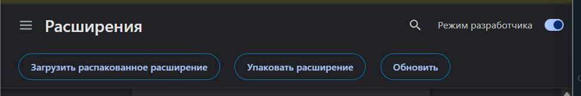

# ColaboratorExtension

---

## Установка

Скачайте архив **ColaboratorExtension.zip** (пароль: `ColaboratorExtension`) и распакуйте его в любое удобное место.

---

### Установка в Google Chrome

Перейдите в:
```

chrome://extensions/

```

---

Включите **режим разработчика**.



После этого нажмите **“Загрузить распакованное расширение”** и выберите папку с распакованным расширением.

---

После выбора папки расширение будет автоматически установлено и готово к использованию.


# Как использовать ColaboratorExtension

---

## 1. Общий принцип работы

Расширение управляет **сессиями**, каждая из которых имеет:
- публичный URL
- приватный URL
- ключ шифрования
- журнал запросов/ответов
- состояние (вкл/выкл)

---

## 2. Создание сессии

На главной странице нажмите:
```

＋ Add

```

Будет создана новая сессия (максимум 10).

---

## 3. Управление сессией

Для каждой сессии доступны действия:

- **Open** — открыть детальную страницу
- **Start / Stop** — включить или выключить polling
- **Copy config** — скопировать конфигурацию
- **Delete** — удалить сессию

---

## 4. Запуск и остановка

- **Start** — включает периодический опрос сервера (polling)
- **Stop** — останавливает активность

Также можно запускать сразу несколько выбранных сессий:
```

Start selected / Stop selected

```

---

## 5. Поиск

Вверху есть поле:
```

Search by name or URL

```
Позволяет фильтровать список сессий.

---

## 6. Импорт и экспорт

### Экспорт
```

Export

```
Создаёт файл с списком всех сессий.

### Импорт
```

Import

```
Позволяет загрузить ранее сохранённый файл.

---

## 7. Работа с сессией (детальный экран)

Внутри сессии доступны:

- Public URL / Private URL
- Secret key (256-bit)
- Статус polling
- Логи запросов

---

## 8. Логи

Отображаются:
- время запроса
- клиент
- протокол
- бинарные данные запроса/ответа

Можно:
- фильтровать
- очищать
- копировать HEX / Base64

---

## 9. HTTP Viewer

Позволяет просматривать:
- Request (байты / ASCII)
- Response (байты / ASCII)

---

## 10. Тема оформления

Кнопка:
```

Theme

```

Переключает:
- светлую тему
- тёмную тему

Настройка сохраняется в браузере автоматически.

---

## 11. Быстрые действия

- `Send now` — мгновенный запрос к серверу
- `Clear logs` — очистка логов
- `Delete session` — удаление сессии
